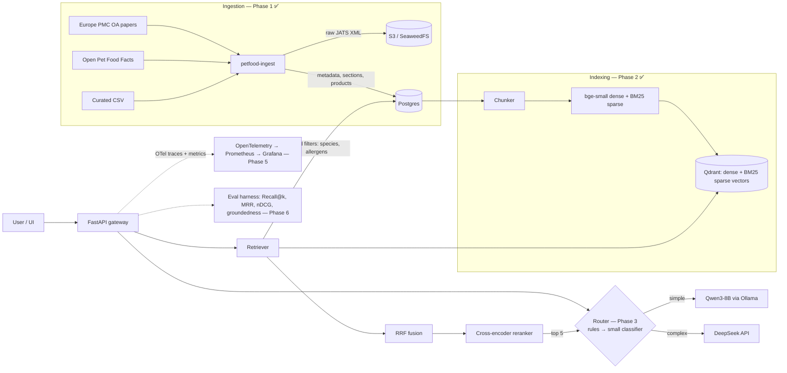

# Architecture

An LLM-based pet food recommender. Answers are grounded in **open-access veterinary
literature** and **real product data** (ingredients plus guaranteed analysis).

## Target system



## Request flow (Phase 4 target)

1. **Parse**: the pet profile (species, age, weight, conditions, allergies) plus a free-text question.
2. **Hard filter in Postgres**: species and life stage, and exclusion of allergens via `allergen_tags`.
   Safety constraints are never left to the LLM.
3. **Hybrid retrieval in Qdrant**:
   - Dense search for meaning ("food for a cat that won't drink water").
   - BM25/sparse search for exact terms ("struvite", "taurine", "CKD").
   - The two result lists are merged with Reciprocal Rank Fusion (RRF).
4. **Rerank**: a cross-encoder rescores about the top 30 candidates and keeps the **top 5**.
5. **Route**: the router sends simple requests to the local Qwen3 model and complex ones to DeepSeek.
6. **Generate**: a structured answer with recommended products, the reasons for each, and
   citations to papers (PMC IDs). A "consult your vet" note is added when medical conditions are involved.

## Data model (Postgres)

| Table | Purpose |
|---|---|
| `papers` | One row per open-access article. Holds the license, species and topic tags, and the S3 key of the raw XML |
| `paper_sections` | Parsed full-text sections (abstract, methods, results…). Chunked in Phase 2 |
| `products` | Normalized products: ingredients, `protein_sources`, `allergen_tags`, guaranteed analysis |
| `chunks` | One row per retrievable passage. Its `id` equals the Qdrant point id |
| `ingestion_runs` | Audit log of every ingestion run (counts, status, errors) |

Postgres is the **source of truth**. Qdrant is a **derived index** and can always be rebuilt from `chunks`.

## Repo layout

```
db/init/            schema SQL (auto-applied by docker compose)
src/petfood/
  config.py         settings from .env
  models.py         Paper / Product / Section (pydantic)
  db.py             SQL access layer
  storage.py        S3-compatible client (SeaweedFS locally, AWS S3 in prod)
  ingest/           Europe PMC, Open Pet Food Facts, curated CSV, JATS parser, tagging rules
tests/              unit tests (offline) + Postgres integration tests
docs/               this file and the design decisions
```
